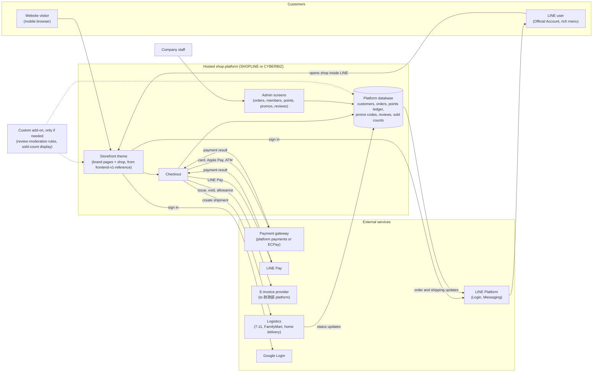
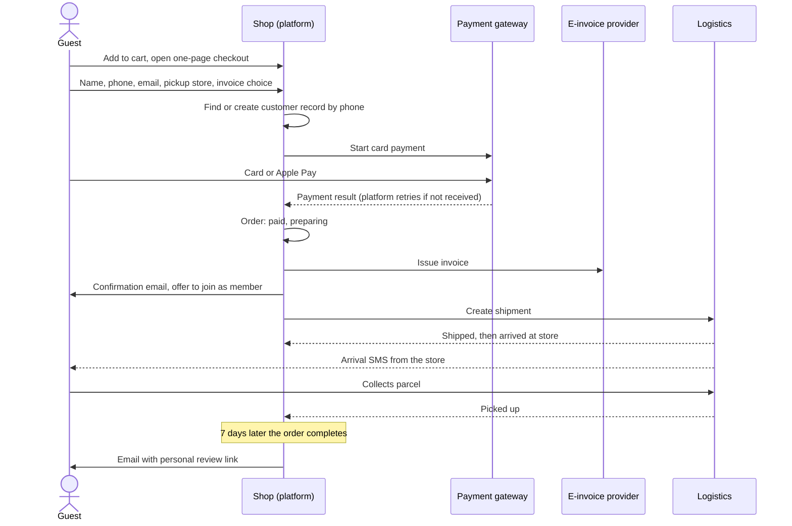
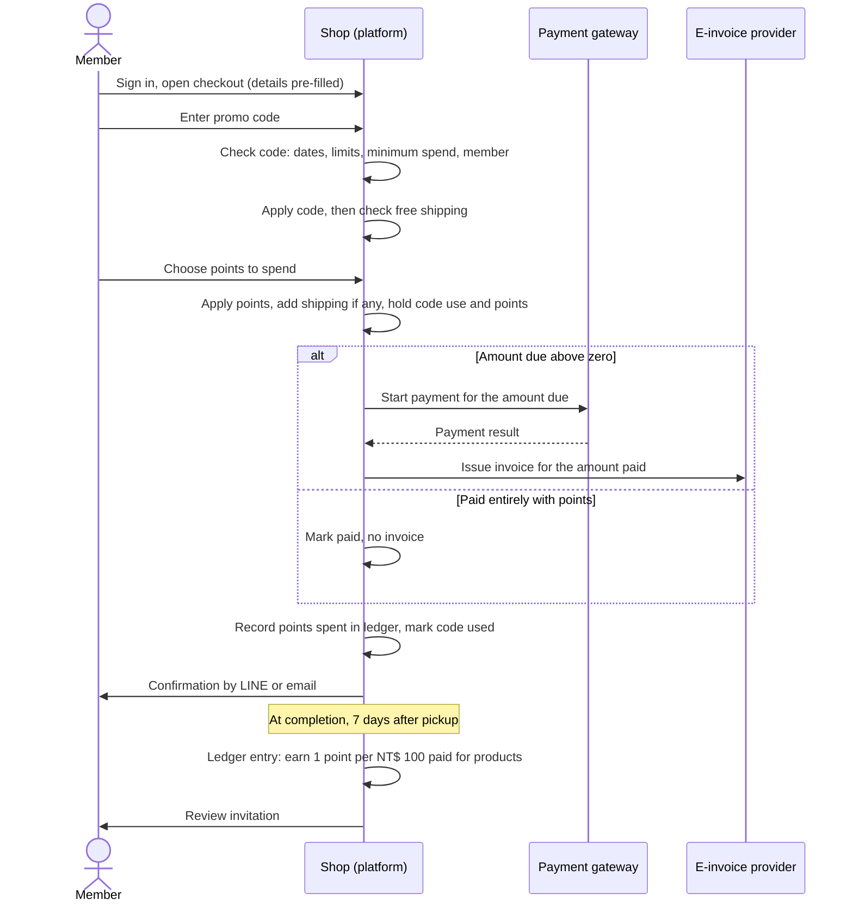
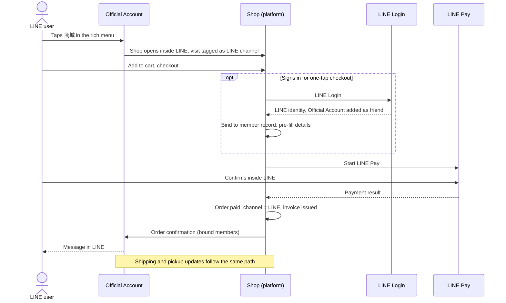
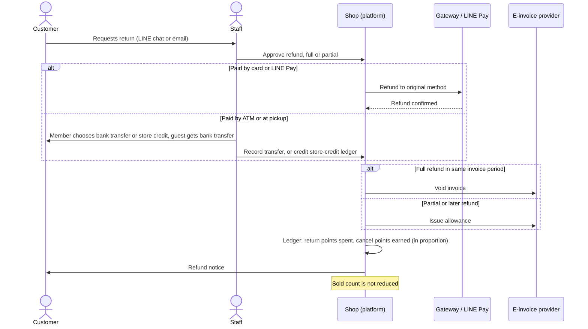

# 衛熹生醫 Dr. Wellsey: payment, membership and reviews design

Status: design agreed in brainstorming, 2026-11-25. No implementation has started.
One decision is still open and blocks the build: **which hosted platform** (section 9).

All fees and prices in this document are rough ranges from general knowledge, not quotes. Taiwan gateways and shop platforms price by contract, so every figure must be replaced with a real quote before it is relied on.

---

## 1. Where we start from

- The current site is one static page (`index.html`) on GitHub Pages, with a mocked-up shop: three hardcoded products, a cart that is only a counter, and no checkout, accounts, orders, or backend of any kind.
- It has no real page addresses, so nothing can link to a product and a payment provider has nowhere to send a customer back to.
- The design is preserved untouched on the branch **`frontend-v1-reference`** (commit `4adae86`). That branch is the visual source of truth for the migration.

## 2. Decisions and why

### Foundations

| Decision | Why |
|---|---|
| **Hosted shop platform** (shortlist: SHOPLINE, CYBERBIZ) rather than a custom backend | The team operates through admin screens and has no backend engineer. The Taiwan-specific pieces (invoice voids, 超商 logistics, payment reconciliation) are a permanent maintenance load that a platform absorbs. |
| **Migrate the frontend** into the platform's theme; brand pages and shop become one site | One site with real product addresses, needed for LINE links, payment returns and search. The current page is about 700 lines, so rebuilding it is cheap. |
| **LINE is a channel into the same checkout**, not a separate store | This is how most Taiwan brands sell through LINE. Orders carry a channel tag (LINE or website), so members, points and counts are shared with no syncing. |
| No subscriptions or auto-reorder for now; plan for high order volume | Agreed scope. |

### Identity and accounts

| Decision | Why |
|---|---|
| Guest checkout; no account needed to buy | Core requirement. |
| One customer record for guests and members. **Phone is the main identifier** (provisional); **email is required** at checkout | Phone is needed for 超商取貨 anyway. Email delivers the e-invoice and guest order updates at no per-message cost. |
| A guest who signs up later claims their past orders only after verifying the phone or email by one-time code | Prevents anyone seeing another person's orders and address. |
| Records merge only on a verified phone or email, never on an unverified match | Same reason. LINE shares a customer's email only if LINE approves an application, so it cannot be relied on. |
| Member login: **LINE, Google, or email + password**; LINE shown first on mobile | LINE is one tap on mobile and automatic inside LINE. One member can attach several login methods. |
| Guests earn no points, with no retroactive award after sign-up | Keeps the rules simple; points become the reason to join. |
| No membership tiers | Deferred. |

### Orders and checkout

| Decision | Why |
|---|---|
| **One-page checkout**, guest by default, with a "用 LINE 快速結帳" shortcut that signs in and pre-fills | Fewest taps on mobile. |
| Two statuses per order: payment and shipping | Staff and customers can see exactly where an order is. |
| Unpaid ATM orders **expire after 3 days**, releasing stock, promo code use and spent points | Stops orders sitting in "pending" forever. |
| An order is **complete 7 days after pickup or delivery** | The return window has closed, so points and review invitations rarely need reversing. |
| Delivery: 7-11 and FamilyMart pickup plus home delivery (provisional); room temperature | Most common methods in Taiwan. |
| Flat shipping fee with a free-shipping threshold (amounts not yet set) | Agreed. |
| **超商取貨付款 allowed**, with an order-value cap and a block on a phone number after two uncollected parcels | Uncollected parcels are the main abuse risk when guests can order. |
| Ships from the company warehouse (provisional) | Agreed. |

### Payments and e-invoices

| Decision | Why |
|---|---|
| Methods on: **credit card (with Apple Pay / Google Pay), LINE Pay, ATM virtual account, 超商取貨付款** | Covers the common ways to pay. |
| Methods off: 超商代碼, 街口, instalments | 超商代碼 duplicates ATM and pay-at-pickup and adds unpaid orders; the others can be added on demand. |
| Gateway setup decided with the platform, on total cost: either the platform's own payments plus LINE Pay, or ECPay 綠界 for payments, invoices and logistics plus LINE Pay | Cannot be settled without real quotes. |
| E-invoices issued automatically: at payment for prepaid orders, at shipment for pay-at-pickup | No staff action. Timing to be confirmed by the accountant. |
| Checkout offers four invoice choices: member/email carrier (default), 手機條碼載具, donation (愛心碼), company invoice with 統編 | Legal requirement, and clinic customers need 統編 invoices. |
| Refund invoices: void (作廢) for a full refund in the same invoice period; allowance (折讓) for a partial or later refund | Standard practice; must be automatic from the refund screen. |
| ATM and pay-at-pickup refunds: member chooses bank transfer or store credit (購物金); guests get bank transfer | There is no card to refund to, and guests have no account to hold credit. |

### Points

| Decision | Why |
|---|---|
| The platform keeps a ledger: every earn, spend and reversal is its own entry | A plain balance cannot be audited or corrected. |
| Earn **1 point per NT$ 100 actually paid for products** (after promo code and points, excluding shipping) | Simple 1% back. |
| Points arrive at order completion | Returns happen before the points exist. |
| 1 point = NT$ 1; **no redeem cap; no expiry** | Agreed. An order can be paid entirely in points; it then has no invoice, and shipping still applies unless the free-shipping threshold is met. |
| No bonus points at launch (sign-up, birthday, reviews) | Deferred. |
| Refund or cancellation: spent points returned, earned points cancelled, both in proportion on a partial refund; balance never goes below zero | Symmetric and easy to explain. |
| Points and store credit are separate balances | Points are a reward. Store credit from a refund is the customer's money: it never expires and can be requested as cash. |

### Promo codes

| Decision | Why |
|---|---|
| **All promo codes require a member account** | Guest identity is too weak to enforce "once per customer". |
| One code per order; a code and points can be combined | Customers are never told they cannot use their points. |
| Discount order: automatic promotions, then promo code, then the free-shipping check, then points, then shipping | Points behave like payment, so spending them does not cost the customer free shipping. |
| Code settings: percentage, fixed amount or free shipping; minimum spend; dates; total and per-member limits; campaign and channel tag | Standard controls, plus tracking of which channel drove the sale. |
| Cancelled or expired orders return the code use. Partial refunds spread the discount across items in proportion; minimum spend is not re-checked | Refund for an item equals what was really paid for it. |
| No launch offers and no automatic promotions for now | Deferred. |

### LINE

| Decision | Why |
|---|---|
| Standard depth: Official Account, rich menu (商城 / 我的訂單 / 會員點數 / 客服), LINE Login, account binding, order and shipping updates through LINE, LINE Pay | Covers what customers expect without ongoing campaign work. |
| LINE Login adds the Official Account as a friend, stated on the login screen | Standard way to grow the LINE audience; disclosed so it is not a surprise. |
| LINE chat is the main support channel, staffed by the company, with an auto-reply | Agreed. |
| Order updates go to any bound member; promotional messages based on purchase history need separate marketing consent | 個資法. |
| Guests get updates by email; the convenience store sends its own arrival SMS | Guests have no LINE binding. |

### Reviews

| Decision | Why |
|---|---|
| Stored against the exact item bought (including pack size); **displayed rolled up per formula; never across formulas** | Today each product is its own formula, so this only matters once pack sizes or bundles exist. A Sleep Well review under Glow Well would mislead. |
| Only buyers can review: members from order history, guests from a personal link in the order-completion email. Every review carries a verified-purchase badge | Proves purchase without an account, and removes most spam. |
| One review per product per order, opened at order completion | The customer has had the product for a week. |
| **Moderation:** 4–5 stars with clean text publish instantly; everything else goes to a staff queue | Agreed approach, made safe by the safeguards below. |
| Safeguard: "clean" means no health-claim language; such reviews are queued however positive | A food seller displaying "治好了我的失眠" risks a prohibited efficacy claim (食品安全衛生管理法 Art. 28). |
| Safeguard: every review's star rating counts in the average immediately | The average is never skewed by the queue. |
| Safeguard: queued reviews **publish automatically after 3 working days** if staff have not acted | A negative review left in a queue is the same as hiding it (公平交易法 Art. 21). |
| Safeguard: fixed rejection reasons only (health claim, spam or advertising, abuse, personal data, not about the product); the reviewer is told why and can resubmit | "Negative" is never a reason. |
| Negative reviews get a public reply rather than removal | Trust. |
| Display: masked name, date, pack bought, full star breakdown, newest first | Honest presentation. |
| No points for reviews; no photos at launch | Deferred. |
| Page copy changes from "實際購買的會員" to "實際購買的顧客" | Guests can review. |

If the lawyer objects to routing by sentiment, the fallback is to apply the same content filter to every review regardless of stars. Nothing else in the design changes.

### Purchase count

| Decision | Why |
|---|---|
| Use the platform's built-in sold counter; LINE and website are combined automatically | Both channels share one checkout, so there is nothing to sync. |
| Shown rounded down with a "+", and hidden under 100 (both provisional, and both depend on the platform offering those settings) | Agreed. |
| **Refunds do not reduce the count** | Agreed. Flagged for the lawyer: a figure that includes returned goods could be challenged as overstated. |
| No sales from before the new shop are included, and no made-up starting number | No records exist to support one. |

### Infrastructure and launch

| Decision | Why |
|---|---|
| Soft launch at a temporary address with real test orders (every payment and delivery method, and a refund), then switch the domain | Staff find the problems instead of customers. |
| The company owns the domain and DNS account directly | Main protection against lock-in. |
| One named staff account per person, two-step login, roles limited to the job, one or two people able to export customer data | Practical core of 個資法 compliance. |
| Required pages: privacy policy, member terms (with the right to change the points program on notice), return policy, food-business registration details | Legal and trust requirements. |
| Tracking: Google Analytics and LINE Tag at launch; Meta Pixel added when Meta ads start. All disclosed in the privacy policy | Measure what is used; add the rest when needed. |
| Scheduled export of customers, orders, points and reviews | Backup and exit plan. |

## 3. Architecture

Orders from both channels land in the same database with a channel tag. The dotted add-on exists only if the chosen platform cannot do the review rules or sold-count display itself.

## 4. Data model (conceptual)

The platform owns the real schema. This draft describes what must exist, for three uses: scoring the platforms, checking that exports are complete, and building any custom add-on.

| Entity | Key fields | Notes |
|---|---|---|
| **Customer** | id, phone (main identifier), phone_verified, email, email_verified, name, is_member, marketing_consent, consent_time, created_at | One record whether guest or member. |
| **LoginIdentity** | id, customer_id, provider (line / google / email), provider_user_id, linked_at | Several per member. The LINE identity also enables messaging. |
| **Product** (formula) | id, name, category, description, status | Sleep Well, Focus Well, Glow Well. Reviews and counts roll up here. |
| **Variant** (sellable item) | id, product_id, sku, pack_size, price_twd, stock | Today one per product (30 包 / 盒). |
| **Order** | id, order_no, customer_id, channel (line / web), payment_status, shipping_status, items_total, promo_discount, points_used, shipping_fee, amount_due, payment_method, expires_at, completed_at | amount_due = items_total − promo_discount − points_used + shipping_fee. |
| **OrderItem** | id, order_id, variant_id, qty, unit_price, allocated_promo_discount, allocated_points | The allocations make partial refunds exact. |
| **Payment** | id, order_id, gateway, method, gateway_txn_id, amount, status, paid_at | gateway_txn_id is the key for reconciliation against payout reports. |
| **Shipment** | id, order_id, method (7-11 / FamilyMart / home), store_code, tracking_no, status, shipped_at, arrived_at, picked_up_at, returned_at | Uncollected returns feed the pay-at-pickup block. |
| **Invoice** | id, order_id, invoice_no, carrier_type (member / mobile barcode / donation / 統編), carrier_value, buyer_tax_id, amount, issued_at, status (issued / void) | |
| **InvoiceAllowance** | id, invoice_id, amount, issued_at | Partial or later refunds. |
| **Refund** | id, order_id, items, amount, method (original / bank transfer / store credit), reason, status, created_by, created_at | |
| **PointsLedger** | id, customer_id, order_id, type (earn / spend / return / cancel / adjust), points, created_at, note | Balance is the sum of entries. Each order can earn once. |
| **StoreCreditLedger** | id, customer_id, refund_id, amount, type (credit / spend / cash-out), created_at | Separate from points; never expires. |
| **PromoCode** | id, code, type (percent / fixed / free shipping), value, min_spend, starts_at, ends_at, total_limit, per_member_limit, campaign, channel | Members only. |
| **PromoRedemption** | id, promo_code_id, customer_id, order_id, status (held / used / released) | Released when an order is cancelled or expires. |
| **Review** | id, product_id, variant_id, order_item_id, customer_id, stars, text, status (published / queued / rejected), reject_reason, submitted_at, publish_deadline, published_at | Stars count in the average from submission, whatever the status. |
| **ReviewReply** | id, review_id, staff_id, text, created_at | Public brand reply. |
| **PhoneBlock** | phone, uncollected_count, blocked_from_pay_at_pickup | |
| **StaffAccount** | id, name, role, two_step_enabled, can_export | |

## 5. Key flows

### 5.1 Guest checkout (credit card, 超商取貨)

### 5.2 Member checkout with promo code and points

If payment fails or an ATM order expires unpaid, the held points and the code use are released.

### 5.3 LINE purchase

A LINE user can also check out as a guest; they then get updates by email instead of LINE.

### 5.4 Refund

Each day staff compare the gateway payout report with paid and refunded orders and investigate any mismatch.

## 6. Legal points to confirm

These reflect our understanding and must be confirmed by the company's lawyer or accountant.

- **食品安全衛生管理法 Art. 28:** reviews shown on the seller's page may count as its advertising; health and efficacy claims are prohibited for food. Drives the health-claim filter.
- **公平交易法 Art. 21:** review presentation and the sold count must not mislead. Drives the review safeguards; the refund-inclusive sold count is the open risk.
- **消費者保護法 7-day return right:** assumed to apply to sealed probiotic powder; whether opened boxes can be refused is unconfirmed.
- **個資法:** collect only what an order needs, state purpose and retention, separate unticked marketing consent, deletion on request (order and invoice records kept for the legally required period), limited staff access, incident notification.
- **E-invoice timing** for prepaid versus pay-at-pickup orders.
- **食品業者登錄** registration shown on the site.

## 7. External services and rough costs

Unverified ranges. Replace with quotes.

| Service | Purpose | Rough cost |
|---|---|---|
| Shop platform (SHOPLINE or CYBERBIZ) | Storefront, checkout, members, points, promos, reviews, admin | Annual plan in the tens of thousands of NT$, plus a reported cut of sales around 1–2%. Quote needed. |
| Card payments (platform's own, or ECPay 綠界) | Credit card, Apple Pay / Google Pay, ATM virtual account | Cards roughly 2–3% of the amount; ATM about 1%. |
| LINE Pay | Payment inside LINE | Roughly 2–3%. Merchant application needed; start early. |
| E-invoice provider (bundled by the platform or ECPay) | Issue, void, allowance, winner notices | Often a small per-invoice or monthly fee. Quote needed. |
| Logistics (7-11, FamilyMart, home delivery) | Pickup and delivery, pay-at-pickup collection | Roughly NT$ 50–70 per pickup parcel, more for home delivery, plus a collection fee on pay-at-pickup. Quote needed. |
| LINE Official Account | Rich menu, chat, order updates | Free tier with a small monthly message allowance; paid plans from roughly NT$ 800 per month, plus per-message charges beyond the allowance. |
| LINE Login, Google Login | Member sign-in | Free. |
| Google Analytics, LINE Tag | Measurement | Free. |
| Domain | Site address | About NT$ 1,000 per year. |
| Custom add-on (only if needed) | Review rules or sold-count display | Small hosting cost plus one-off build time. |

## 8. Open items

### To check with the company

1. Phone as the main customer identifier.
2. Delivery methods (provisionally 7-11 and FamilyMart pickup plus home delivery).
3. Whether the company warehouse ships, or an outside warehouse.
4. Shipping fee amount, free-shipping threshold, and the pay-at-pickup order-value cap.
5. Current 電子發票 provider, if any.
6. Whether a LINE Official Account exists and is verified.
7. Gateway contract and LINE Pay merchant account: none yet; applications need starting.
8. Budget range for a platform plan.
9. Domain: whether the company owns one and who controls it.
10. Sold-count display: rounded down with a "+", hidden under 100.
11. Staff: how many need admin access, and whether the four roles fit (orders and shipping, customer service, marketing, finance).
12. Who answers LINE support and the hours; who moderates reviews and writes replies.
13. Expected monthly LINE message volume.
14. Who is responsible for a data incident.
15. 食品業者登錄 registration number.
16. Accountant: invoice timing; non-expiring points as a growing liability.
17. Lawyer: review moderation approach and a health-claim word list; a sold count that keeps refunded units; returns of opened boxes; member terms allowing changes to the points program.

### Design questions not yet settled

- Platform: SHOPLINE or CYBERBIZ (section 9).
- Gateway setup: platform's own payments or ECPay.
- Whether a review stays published if its order is later refunded.
- LINE examples (below).

### LINE examples: to be added

<!-- PASTE LINE EXAMPLES HERE WHEN AVAILABLE -->

When supplied, they are expected to affect the rich menu layout and wording, how the member card and points appear inside LINE, whether to add a friend-add coupon, how much marketing automation to add, and possibly membership tiers. None would undo a decision above.

## 9. Platform scoring sheet

Ask both sales teams the same questions and record yes / no / add-on / custom for each.

**Cost**
- Plan price, percentage cut of sales, own-payments card rate.
- Whether using ECPay instead changes the cut.
- E-invoice and logistics fees.

**Accounts and checkout**
- Guest checkout, with guest orders claimable after sign-up by verified phone or email.
- LINE, Google and email login on one member record.
- One-page checkout with a LINE quick-checkout shortcut.
- Automatic expiry of unpaid orders after a set number of days.
- Blocking a phone number from pay-at-pickup; order-value cap on pay-at-pickup.

**Payments and invoices**
- Card with Apple Pay / Google Pay, LINE Pay, ATM virtual account, pay-at-pickup.
- Automatic invoice issue, void and allowance; all four invoice choices at checkout.
- Orders with a NT$ 0 product total handled correctly, with no invoice.
- Payout reports that can be matched to orders.

**Points and promos**
- Points and store credit as two separate balances.
- Points awarded at order completion, not at payment; no expiry; no redeem cap.
- Proportional points adjustment on partial refunds.
- Promo code and points on one order, in the agreed order, with the free-shipping check before points.
- Member-only codes; code use returned on cancellation; campaign and channel tags.

**LINE**
- Official Account binding; order and shipping updates through LINE.
- Rich menu links into member pages without a second login.
- Orders tagged by channel in reports.

**Reviews** (most likely to need custom work)
- Purchase-only reviews, including a guest review link.
- Rule-based auto-publish by stars, keyword filter, timed auto-publish from the queue.
- Stars counted in the average while text is queued.
- Public replies, star breakdown, roll-up across pack sizes.
- If not built in: available add-ons or custom options.

**Sold count**
- Definition used; rounding and minimum-display settings; no forced starting number.

**Theme and operations**
- How closely the theme can match `frontend-v1-reference`.
- Temporary address for a soft launch.
- Staff roles, two-step login, limits on customer-data export.
- Full export of customers, orders, points and reviews.

## 10. Suggested build order

**Phase 0: before any build**
- Collect the company answers in section 8.
- Get quotes and scoring-sheet answers from both platforms; choose one.
- Start the slow applications: payment gateway, LINE Pay merchant account, Official Account verification, e-invoice provider.
- Lawyer and accountant review of section 6.

**Phase 1: launch (MVP)**
- Rebuild the design as the platform theme, with real product pages.
- Catalog, one-page guest checkout, all four payment methods, e-invoices, 超商 pickup and home delivery.
- Member login (LINE, Google, email) and claiming of guest orders.
- Official Account rich menu, LINE Login with friend-add, order updates through LINE.
- Privacy policy, member terms, return policy, registration details.
- Staff accounts and roles; daily reconciliation routine; scheduled data export.
- Soft launch with real test orders and a refund, then the domain switch.

**Phase 2: shortly after launch**
- Points (earn and redeem) and store credit.
- Promo codes.
- Reviews with the moderation rules, and any custom add-on they need.
- Sold count on product pages.

**Later**
- Repurchase reminder through LINE around day 25.
- Changes driven by the LINE examples.
- Review photos, bonus points, membership tiers, bundles and multi-box discounts, 街口, subscriptions.
