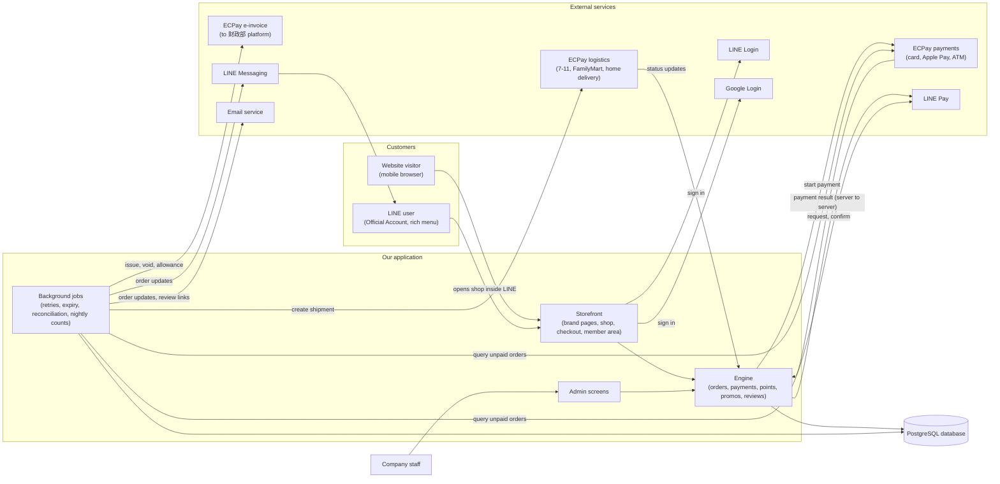
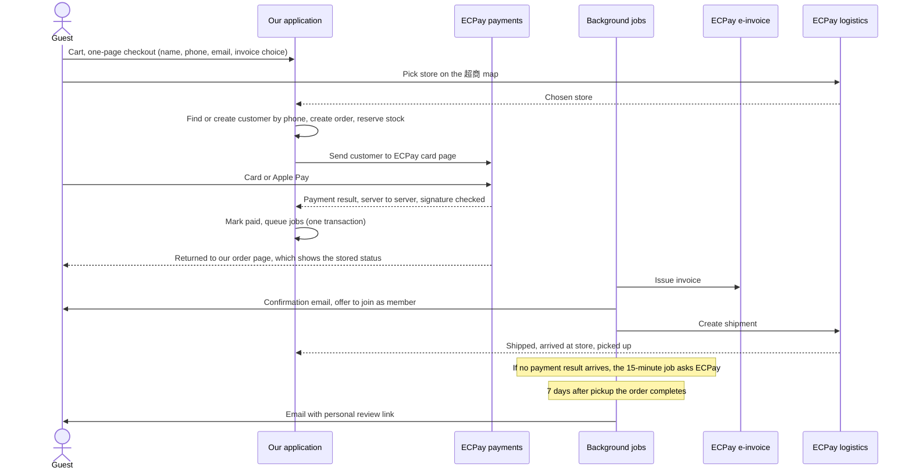
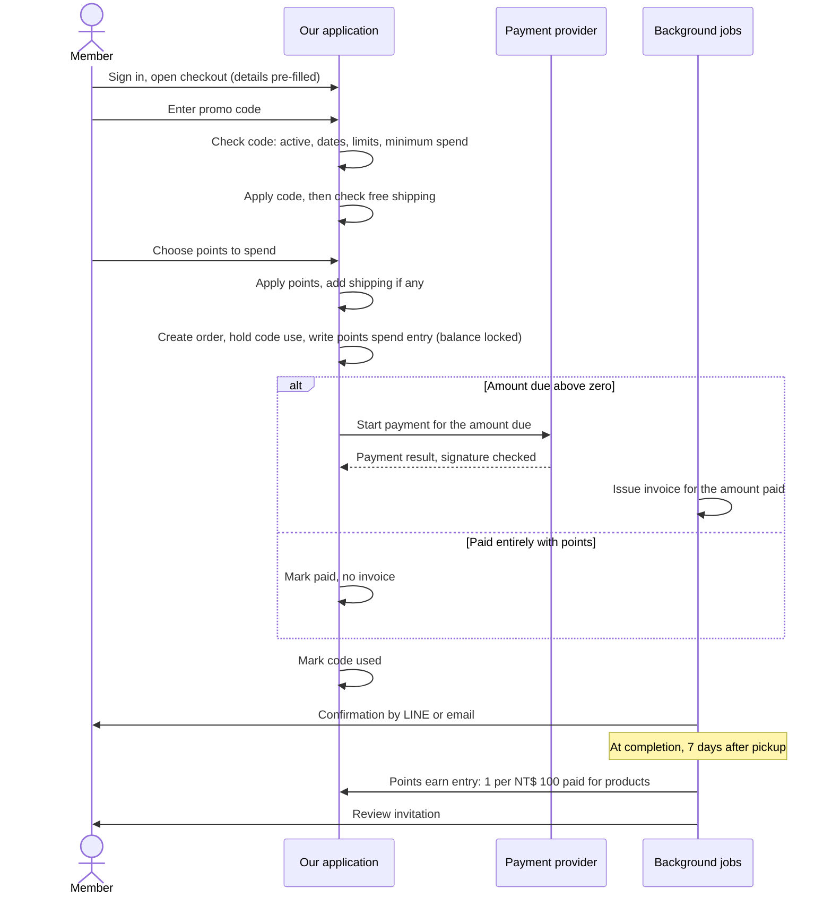
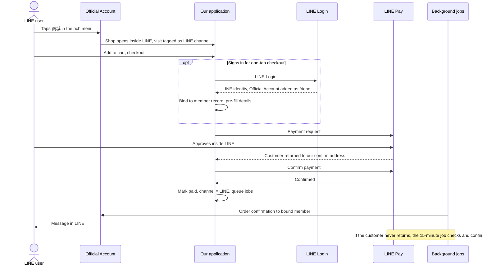
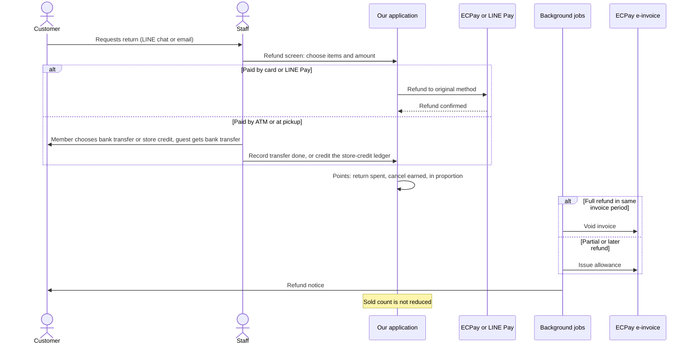

# 衛熹生醫 Dr. Wellsey: shop, payment, membership and reviews design

Status: design revised 2026-11-25. **We are building our own system** for this one company; an earlier plan to use a hosted platform (CYBERBIZ) was dropped. No implementation has started.

All fees and prices in this document are rough ranges from general knowledge, not quotes. Every figure must be replaced with a real quote before it is relied on.

---

## 1. Where we start from

- The current site is one static page (`index.html`) on GitHub Pages with a mocked-up shop: three hardcoded products, a cart that is only a counter, and no checkout, accounts, orders or backend.
- It has no real page addresses, so nothing can link to a product and a payment provider has nowhere to send a customer back to.
- The design is preserved untouched on the branch **`frontend-v1-reference`** (commit `4adae86`). That branch is the visual source of truth.

## 2. What "our own system" means

One web application, built and owned by the company, containing three things:

1. **The storefront**: the current design rebuilt with real pages, a cart, checkout, login and member area. Every screen, including checkout, is ours to design.
2. **The admin**: screens for staff to run the shop. **No task in daily operation requires code** (section 6).
3. **The engine**: orders, payments, invoices, shipping, points, promo codes, reviews and counts, with the outside services connected to it.

Two honest limits on "nobody needs to code":

- **Running the shop needs no code.** Products, prices, orders, refunds, promo codes, reviews, settings and page text are all edited in admin screens.
- **Keeping the system alive still needs a technical owner.** Payment and invoice providers change their interfaces, security updates are needed, and something will eventually break at night. Someone (an engineer on retainer, an agency, or continued sessions like this one) must be named for that. The admin includes a "problems" screen so staff can see and retry most failures themselves, which reduces how often that person is needed but does not remove the need.

## 3. Decisions and why

### Foundations

| Decision | Why |
|---|---|
| **Custom-built system for this one company** | Full control of every screen and rule; no platform fee or sales cut; no dependence on a platform's limits. Cost: we own payments, invoices and logistics connections permanently. |
| **Rebuild the frontend** inside the new application; brand pages and shop are one site | Real product addresses, needed for LINE links, payment returns and search. |
| **LINE is a channel into the same checkout**, not a separate store | Orders carry a channel tag (LINE or website), so members, points and counts are shared with no syncing. |
| **ECPay 綠界 for card, ATM, e-invoices and logistics; LINE Pay connected directly** | One vendor covers the three Taiwan-specific pieces with one contract and one test environment. Customers pay on ECPay's own card page, so card numbers never touch our system. |
| No subscriptions or auto-reorder for now; plan for high order volume | Agreed scope. |

### Identity and accounts

| Decision | Why |
|---|---|
| Guest checkout; no account needed to buy | Core requirement. |
| One customer record for guests and members. **Phone is the main identifier** (provisional); **email is required** at checkout | Phone is needed for 超商取貨 anyway. Email delivers the e-invoice and guest order updates at no per-message cost. |
| A guest who signs up later claims their past orders only after verifying by one-time code | Prevents anyone seeing another person's orders and address. |
| Records merge only on a verified phone or email, never on an unverified match | Same reason. LINE shares a customer's email only if LINE approves an application, so it cannot be relied on. |
| Member login: **LINE, Google, or email + password**; LINE shown first on mobile | LINE is one tap on mobile and automatic inside LINE. One member can attach several login methods. |
| Guests earn no points, with no retroactive award after sign-up | Keeps the rules simple. |
| No membership tiers | Deferred. |

### Orders and checkout

| Decision | Why |
|---|---|
| **One-page checkout**, guest by default, with a "用 LINE 快速結帳" shortcut that signs in and pre-fills | Fewest taps on mobile. |
| Two statuses per order: payment and shipping | Staff and customers can see exactly where an order is. |
| Unpaid ATM orders **expire after 3 days**, releasing stock, promo code use and spent points | Stops orders sitting in "pending" forever. |
| An order is **complete 7 days after pickup or delivery** | The return window has closed, so points and review invitations rarely need reversing. |
| Delivery: 7-11 and FamilyMart pickup plus home delivery (provisional); room temperature | Most common methods in Taiwan. |
| Flat shipping fee with a free-shipping threshold (amounts not yet set; editable in admin) | Agreed. |
| **超商取貨付款 allowed**, with an order-value cap and a block on a phone number after two uncollected parcels | Uncollected parcels are the main abuse risk when guests can order. |
| Ships from the company warehouse (provisional) | Agreed. |

### Payments and e-invoices

| Decision | Why |
|---|---|
| Methods on: **credit card (with Apple Pay / Google Pay), LINE Pay, ATM virtual account, 超商取貨付款** | Covers the common ways to pay. |
| Methods off: 超商代碼, 街口, instalments | Can be added later. |
| E-invoices issued automatically: at payment for prepaid orders, at shipment for pay-at-pickup | No staff action. Timing to be confirmed by the accountant. |
| Checkout offers four invoice choices: member/email carrier (default), 手機條碼載具, donation (愛心碼), company invoice with 統編 | Legal requirement, and clinic customers need 統編 invoices. |
| Refund invoices: void (作廢) for a full refund in the same invoice period; allowance (折讓) for a partial or later refund; both automatic from the refund screen | Standard practice. |
| ATM and pay-at-pickup refunds: member chooses bank transfer or store credit (購物金); guests get bank transfer | There is no card to refund to, and guests have no account to hold credit. |

### Points

| Decision | Why |
|---|---|
| A ledger: every earn, spend and reversal is its own permanent entry; the balance is their sum | A plain balance field cannot be audited or corrected. |
| Earn **1 point per NT$ 100 actually paid for products** (after promo code and points, excluding shipping) | Simple 1% back. |
| Points arrive at order completion | Returns happen before the points exist. |
| 1 point = NT$ 1; **no redeem cap; no expiry** | Agreed. An order can be paid entirely in points; it then has no invoice, and shipping still applies unless the free-shipping threshold is met. |
| No bonus points at launch (sign-up, birthday, reviews) | Deferred. |
| Refund or cancellation: spent points returned, earned points cancelled, both in proportion on a partial refund; balance never goes below zero | Symmetric and easy to explain. |
| Points and store credit are separate balances | Points are a reward. Store credit from a refund is the customer's money: it never expires and can be requested as cash. |

### Promo codes

| Decision | Why |
|---|---|
| **All promo codes require a member account** | Guest identity is too weak to enforce "once per customer". |
| One code per order; a code and points can be combined | Customers are never told they cannot use their points. |
| Discount order: automatic promotions, then promo code, then the free-shipping check, then points, then shipping | Points behave like payment, so spending them does not cost the customer free shipping. |
| Code settings: percentage, fixed amount or free shipping; minimum spend; dates; total and per-member limits; campaign and channel tag | Standard controls, plus tracking of which channel drove the sale. |
| Cancelled or expired orders return the code use. Partial refunds spread the discount across items in proportion; minimum spend is not re-checked | Refund for an item equals what was really paid for it. |
| No launch offers and no automatic promotions for now | Deferred. |

### LINE

No example programs were supplied; the following is designed on our own judgement.

| Decision | Why |
|---|---|
| Official Account with a four-button rich menu: 商城 / 我的訂單 / 會員點數 / 客服 | The four things a customer comes to LINE to do. The first three open the shop inside LINE, already signed in. |
| LINE Login, which adds the Official Account as a friend, stated on the login screen | Standard way to grow the LINE audience; disclosed so it is not a surprise. |
| Account binding, with order confirmed, shipped, arrived-at-store and review-invite messages through LINE | Customers read LINE; email is the fallback. |
| LINE chat is the main support channel, staffed by the company, with an auto-reply | Agreed. |
| Order updates go to any bound member; promotional messages based on purchase history need separate marketing consent | 個資法. |
| Guests get updates by email; the convenience store sends its own arrival SMS | Guests have no LINE binding. |
| Later phase: a repurchase reminder around day 25 | Every product is a 30-day box. |

### Reviews

| Decision | Why |
|---|---|
| Stored against the exact item bought (including pack size); **displayed rolled up per formula; never across formulas** | A Sleep Well review under Glow Well would mislead. |
| Only buyers can review: members from order history, guests from a personal link in the order-completion email. Every review carries a verified-purchase badge | Proves purchase without an account, and removes most spam. |
| One review per product per order, opened at order completion | The customer has had the product for a week. |
| **Moderation:** 4–5 stars with clean text publish instantly; everything else goes to a staff queue | Agreed approach, made safe by the safeguards below. |
| Safeguard: "clean" means no health-claim language (word list editable in admin); such reviews are queued however positive | A food seller displaying "治好了我的失眠" risks a prohibited efficacy claim (食品安全衛生管理法 Art. 28). |
| Safeguard: every review's star rating counts in the average immediately | The average is never skewed by the queue. |
| Safeguard: queued reviews **publish automatically after 3 working days** if staff have not acted | A negative review left in a queue is the same as hiding it (公平交易法 Art. 21). |
| Safeguard: fixed rejection reasons only (health claim, spam or advertising, abuse, personal data, not about the product); the reviewer is told why and can resubmit | "Negative" is never a reason. |
| Negative reviews get a public reply rather than removal | Trust. |
| Display: masked name, date, pack bought, full star breakdown, newest first | Honest presentation. |
| No points for reviews; no photos at launch | Deferred. |
| Page copy changes from "實際購買的會員" to "實際購買的顧客" | Guests can review. |

### Purchase count

With no platform counter to defer to, the count is defined here, following the answers already given.

| Decision | Why |
|---|---|
| Boxes in paid orders, LINE and website combined, recalculated nightly and stored | One checkout, so one sum. A stored figure loads instantly. |
| **Refunds do not reduce the count** | Agreed. Flagged for the lawyer: a figure that includes returned goods could be challenged as overstated. |
| Shown rounded down with a "+", hidden under 100 (both provisional; both are admin settings) | Agreed. |
| No sales from before the new shop, and no made-up starting number | No records exist to support one. |

### Infrastructure and launch

| Decision | Why |
|---|---|
| One application for storefront, admin and engine, on managed hosting with a managed database (section 4) | Fewest moving parts; nothing for the company to patch or back up by hand. |
| Soft launch at a temporary address with real test orders (every payment and delivery method, and a refund), then switch the domain | Staff find the problems instead of customers. |
| The company owns the domain, hosting account, and every provider account directly | The company can change who maintains the system without losing anything. |
| One named staff account per person, two-step login, roles limited to the job, one or two people able to export customer data, every admin action logged | Practical core of 個資法 compliance. |
| Required pages: privacy policy, member terms (with the right to change the points program on notice), return policy, food-business registration details; all editable in admin | Legal and trust requirements. |
| Tracking: Google Analytics and LINE Tag at launch; Meta Pixel added when Meta ads start. All disclosed in the privacy policy | Measure what is used. |
| Independent security review before launch | The system holds personal data and moves money. |

## 4. Architecture

Recommended technology (a recommendation, to be confirmed before building):

- **Application:** one TypeScript web application (Next.js) serving the storefront, the admin and the server logic.
- **Database:** managed PostgreSQL with automatic daily backups.
- **Hosting:** a managed container service in Google Cloud's Taiwan region, deployed automatically from this repository. A fixed outbound address is needed because LINE Pay, as far as we know, requires the caller's address to be registered.
- **Background work:** a scheduler plus a job table in the database, for retries, expiries and nightly tasks.
- **Supporting services:** transactional email, error monitoring, image storage.

## 5. Reliability rules

These are the rules the engine follows so that money, stock and points stay correct when something fails.

**Orders**
- Prices, discounts, shipping and totals are calculated on the server from the database; nothing sent by the browser is trusted.
- All money is stored as whole NT$.
- Each checkout attempt carries a unique key, so a double tap or a retry cannot create two orders.
- Stock is reserved when the order is created and released if it is cancelled or expires.

**Payments**
- An order becomes paid only when the provider tells our server directly and the message's signature checks out. The customer's browser returning to the site is never treated as proof.
- Every provider message is stored as received. The same message arriving twice has no second effect.
- Order state changes happen inside one database transaction, following a fixed set of allowed steps (for example, a cancelled order cannot become shipped).
- **Reconciliation job, every 15 minutes:** any order still unpaid after a short wait is checked with the provider directly, which catches messages that never arrived. LINE Pay payments that the customer approved but did not return from are confirmed the same way.
- **Nightly:** paid and refunded orders are compared with the provider's settlement records; mismatches appear on the admin "problems" screen.
- **Expiry job:** unpaid ATM orders are cancelled after 3 days, releasing stock, the promo code use and spent points.

**Side effects (invoice, shipment, messages)**
- Paying an order does not call the invoice, logistics or messaging services directly. It writes jobs into a table in the same transaction; a worker runs them and retries failures with increasing delays.
- A job that keeps failing shows on the "problems" screen with a retry button and a plain-language explanation, so staff can act without a developer.

**Points, store credit and promo codes**
- Ledgers are append-only: entries are never edited or deleted, only reversed by a new entry.
- The database enforces that an order can earn points once and that a code use is counted once.
- Spending locks the customer's balance for the moment of the transaction, so two simultaneous orders cannot spend the same points.

**Security and personal data**
- Card numbers never reach our system; customers enter them on ECPay's page.
- Provider keys are stored in the host's secret store, not in the code.
- Admin requires two-step login; every admin action and every data export is logged with who and when.
- Login, one-time codes, promo code entry and review submission are rate-limited.
- Deleting a member removes personal details but keeps order and invoice records for the legally required period.

## 6. Admin screens

The rule: if staff need it to run the shop, it is a screen. All in Traditional Chinese.

| Screen | What staff do there |
|---|---|
| **Home** | Today's orders and revenue; items needing attention (orders to ship, reviews waiting, refunds requested, problems). |
| **Orders** | Search and filter; open an order to see payment, shipping, invoice, points and messages in one place; cancel; refund in full or part (invoice, points and refund method handled automatically). |
| **Shipping** | Orders ready to ship; print 超商 and courier labels in batches; mark shipped; see parcels arrived, collected, or returned uncollected. |
| **Customers** | Profile, orders, points and store-credit history; adjust points with a required reason; merge duplicate records; block a phone number from pay-at-pickup; delete a member. |
| **Products** | Add and edit name, description, photos, price, pack size, stock, ingredients; publish or hide. |
| **Promo codes** | Create and end codes; set type, value, minimum spend, dates, limits, campaign tag; see usage. |
| **Reviews** | The queue with days remaining before auto-publish; approve, reject with a listed reason, write a public reply. |
| **Content** | Edit text and images on the brand pages, 科普 articles, and the policy pages. |
| **Settings** | Shipping fee and free-shipping threshold; pay-at-pickup cap; points rate; review rules and the health-claim word list; sold-count rounding and minimum; message templates; payment methods on or off. |
| **Reports** | Sales by day, product and channel (LINE or website); promo code results; points outstanding; daily reconciliation; file exports. |
| **Staff** | Add and remove staff, assign roles, see the action log. |
| **Problems** | Anything that failed (an invoice not issued, a message not sent, a payment mismatch), explained in plain language, with a retry button and a note on when to call the technical owner. |

## 7. Data model

| Table | Key fields | Notes |
|---|---|---|
| **customers** | id, phone, phone_verified_at, email, email_verified_at, name, is_member, marketing_consent_at, cod_blocked, deleted_at | One record whether guest or member. |
| **login_identities** | id, customer_id, provider (line / google / email), provider_user_id, password_hash | Several per member. Unique on provider + provider_user_id. |
| **one_time_codes** | id, target (phone or email), code_hash, purpose, expires_at, used_at | For verification and claiming guest orders. |
| **products** | id, slug, name, category, description, status | A formula. Reviews and counts roll up here. |
| **variants** | id, product_id, sku, pack_size, price, stock, reserved | The sellable item. |
| **orders** | id, order_no, customer_id, channel (line / web), payment_status, shipping_status, items_total, promo_discount, points_used, shipping_fee, amount_due, payment_method, checkout_key, expires_at, paid_at, completed_at | amount_due = items_total − promo_discount − points_used + shipping_fee. Unique on checkout_key. |
| **order_items** | id, order_id, variant_id, qty, unit_price, promo_share, points_share, refunded_qty | The shares make partial refunds exact. |
| **payments** | id, order_id, provider (ecpay / linepay / cod), provider_txn_id, amount, status, paid_at | |
| **payment_events** | id, provider, provider_txn_id, kind, payload, received_at | Every provider message as received. Unique on provider + txn + kind. |
| **shipments** | id, order_id, method (7-11 / FamilyMart / home), store_code, store_name, address, tracking_no, status, shipped_at, arrived_at, picked_up_at, returned_at | |
| **invoices** | id, order_id, invoice_no, carrier_type, carrier_value, buyer_tax_id, donation_code, amount, status (issued / void), issued_at | |
| **invoice_allowances** | id, invoice_id, allowance_no, amount, issued_at | |
| **refunds** | id, order_id, amount, method (original / bank transfer / store credit), bank_account, reason, status, staff_id, created_at | |
| **refund_items** | id, refund_id, order_item_id, qty, amount | |
| **points_ledger** | id, customer_id, order_id, kind (earn / spend / return / cancel / adjust), points, note, staff_id, created_at | Append-only. Unique on order_id + kind where kind = earn. |
| **store_credit_ledger** | id, customer_id, refund_id, order_id, kind (credit / spend / cash-out), amount, created_at | Append-only; never expires. |
| **promo_codes** | id, code, kind (percent / fixed / free shipping), value, min_spend, starts_at, ends_at, total_limit, per_member_limit, campaign, channel, active | |
| **promo_redemptions** | id, promo_code_id, customer_id, order_id, status (held / used / released) | Unique on order_id. |
| **reviews** | id, product_id, variant_id, order_item_id, customer_id, stars, body, status (published / queued / rejected), flag_reason, reject_reason, auto_publish_at, published_at | Unique on order_item_id. Stars count in the average whatever the status. |
| **review_replies** | id, review_id, staff_id, body, created_at | |
| **review_tokens** | id, order_id, token_hash, expires_at | Guest review links. |
| **product_stats** | product_id, units_sold, star_average, star_counts, updated_at | Recalculated nightly; what the page displays. |
| **jobs** | id, kind, payload, status, attempts, run_after, last_error | Side effects and scheduled work. |
| **messages** | id, customer_id, order_id, channel (line / email), template, status, sent_at | Record of what was sent. |
| **settings** | key, value, updated_by, updated_at | Everything on the Settings screen. |
| **content_pages** | slug, title, body, updated_by, updated_at | Brand, article and policy pages. |
| **staff** | id, name, email, role, two_step_secret, active | |
| **audit_log** | id, staff_id, action, target, detail, created_at | Every admin action and export. |

## 8. Key flows

### 8.1 Guest checkout (credit card, 超商取貨)

### 8.2 Member checkout with promo code and points

If payment fails or an ATM order expires unpaid, the code use is released and a points return entry is written.

### 8.3 LINE purchase

A LINE user can also check out as a guest; they then get updates by email.

### 8.4 Refund

## 9. Legal points to confirm

These reflect our understanding and must be confirmed by the company's lawyer or accountant.

- **食品安全衛生管理法 Art. 28:** reviews shown on the seller's page may count as its advertising; health and efficacy claims are prohibited for food. Drives the health-claim filter.
- **公平交易法 Art. 21:** review presentation and the sold count must not mislead. Drives the review safeguards; the refund-inclusive sold count is the open risk.
- **消費者保護法 7-day return right:** assumed to apply to sealed probiotic powder; whether opened boxes can be refused is unconfirmed.
- **個資法:** collect only what an order needs, state purpose and retention, separate unticked marketing consent, deletion on request, limited staff access, incident notification.
- **E-invoice timing** for prepaid versus pay-at-pickup orders.
- **食品業者登錄** registration shown on the site.

## 10. External services and rough costs

Unverified ranges. Replace with quotes.

| Service | Purpose | Rough cost |
|---|---|---|
| ECPay payments | Credit card, Apple Pay / Google Pay, ATM virtual account | Cards roughly 2–3% of the amount; ATM about 1%. |
| LINE Pay | Payment inside LINE | Roughly 2–3%. Merchant application needed; start early. |
| ECPay e-invoice | Issue, void, allowance, winner notices | Small per-invoice or monthly fee. |
| ECPay logistics | 7-11 and FamilyMart pickup, home delivery, pay-at-pickup collection | Roughly NT$ 50–70 per pickup parcel, more for home delivery, plus a collection fee. |
| Hosting and database | Runs the application | Roughly NT$ 2,000–6,000 per month at launch scale, rising with traffic. |
| LINE Official Account | Rich menu, chat, order updates | Free tier of 200 messages a month; NT$ 800 for 3,000; NT$ 1,200 for 6,000, then per-message charges. |
| Email service | Order updates, one-time codes, review links | Free to a few hundred NT$ per month. |
| LINE Login, Google Login, Google Analytics, LINE Tag | Sign-in and measurement | Free. |
| Error monitoring | Alerts when something breaks | Free tier to about NT$ 1,000 per month. |
| Domain | Site address | About NT$ 1,000 per year. |
| Technical owner | Updates, incidents, provider changes | A retainer; the largest ongoing cost, replacing the platform fee. |
| Security review | Before launch | One-off. |

There is no platform plan and no percentage cut of sales.

## 11. Open items

### To check with the company

1. Phone as the main customer identifier.
2. Delivery methods (provisionally 7-11 and FamilyMart pickup plus home delivery).
3. Whether the company warehouse ships, or an outside warehouse.
4. Shipping fee amount, free-shipping threshold, and the pay-at-pickup order-value cap.
5. Current 電子發票 provider, if any.
6. Whether a LINE Official Account exists and is verified.
7. ECPay merchant account (payments, e-invoice, logistics) and LINE Pay merchant account: none yet; applications need starting.
8. Domain: whether the company owns one and who controls it.
9. Sold-count display: rounded down with a "+", hidden under 100.
10. Staff: how many need admin access, and whether the roles fit (orders and shipping, customer service, marketing, finance).
11. Who answers LINE support and the hours; who moderates reviews and writes replies.
12. Expected monthly LINE message volume.
13. Who is responsible for a data incident.
14. 食品業者登錄 registration number.
15. **Who is the technical owner after launch**, and the budget for it.
16. Who holds the hosting account and pays for it.
17. Accountant: invoice timing; non-expiring points as a growing liability.
18. Lawyer: review moderation approach and a health-claim word list; a sold count that keeps refunded units; returns of opened boxes; member terms allowing changes to the points program.

### Design questions not yet settled

- Technology and hosting in section 4: recommended, not yet confirmed.
- One-time codes by email only at launch, or also by SMS (a per-message cost and one more provider).
- Whether a review stays published if its order is later refunded.
- How much of the brand pages staff should be able to edit: text and images only (recommended), or layout as well.

## 12. Build order

Each phase ends with something that can be shown and tested.

**Phase 0: before building**
- Confirm section 4; create the hosting account in the company's name.
- Start the ECPay and LINE Pay applications and Official Account verification. Building can proceed against the providers' test environments in the meantime.

**Phase 1: storefront and catalog**
- Application skeleton, database, automatic deployment to a temporary address.
- The current design rebuilt as real pages; products served from the database.
- Admin: staff login with two-step, Products, Content, Settings.
- Cart.

**Phase 2: guest checkout and money**
- One-page checkout; ECPay card, ATM and pay-at-pickup; 超商 map and shipments; e-invoices.
- The reliability rules in section 5: provider messages, reconciliation, expiry, job retries.
- Admin: Orders, Shipping, refunds, Problems, Home.
- Order emails.

**Phase 3: members and LINE**
- LINE, Google and email login; claiming guest orders; member area.
- LINE Pay.
- Official Account rich menu, binding, order messages; channel tagging.
- Admin: Customers, Staff roles, action log.

**Phase 4: points, store credit, promo codes**
- Ledgers, checkout integration, refund handling.
- Admin: Promo codes, points adjustment.

**Phase 5: reviews and counts**
- Review links, submission, moderation rules, queue, replies, display.
- Nightly sold count and star statistics.
- Admin: Reviews.

**Phase 6: launch**
- Reports and exports; policy pages; tracking.
- Security review; lawyer and accountant sign-off.
- Soft launch with real test orders and a refund; then the domain switch and the old site turned off.

**Later**
- Repurchase reminder through LINE around day 25.
- Review photos, bonus points, membership tiers, bundles and multi-box discounts, 街口, subscriptions.
